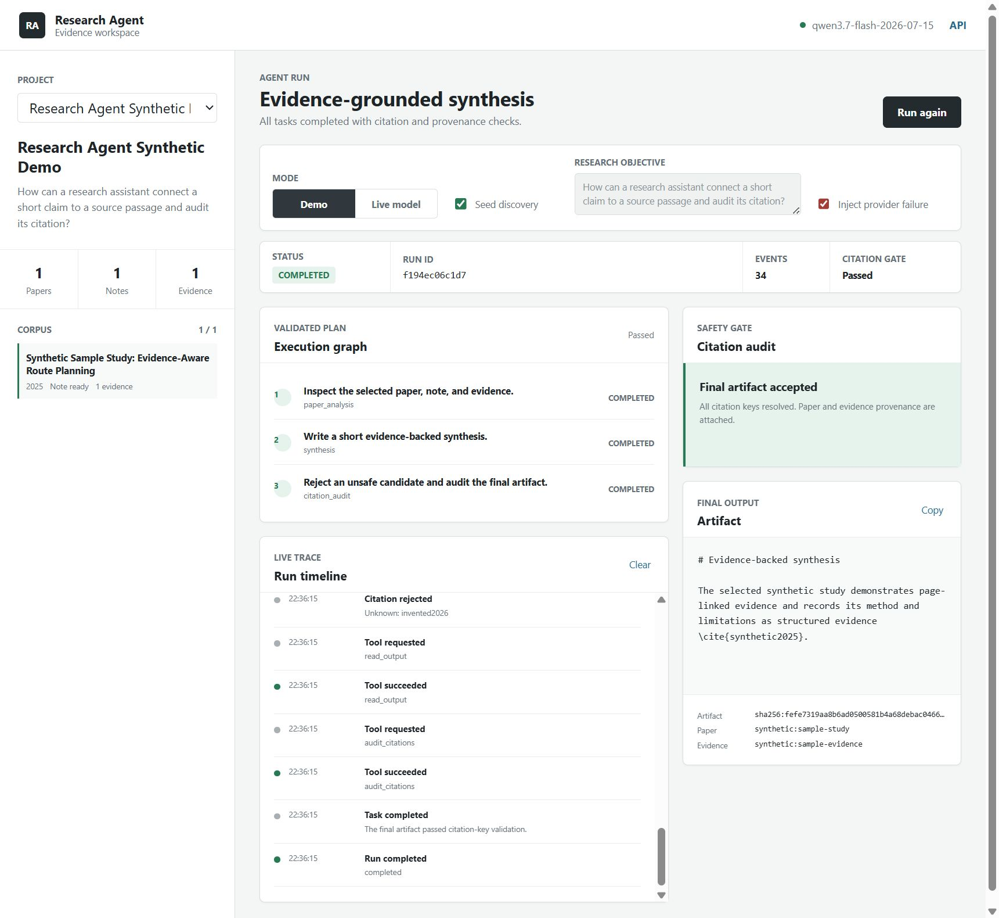

# Research Paper Agent

An evidence-grounded research workflow that expands 1--3 seed papers into a
screened corpus and turns it into an auditable Related Work artifact. The MVP
includes query decomposition, academic search and citation expansion, planning,
task-level tool permissions, resumable execution, page and evidence retrieval,
citation validation, provenance manifests, and a browser run console.

## Install

Requires Python 3.10 or later. From a fresh clone:

```bash
python -m venv .venv
.venv/bin/python -m pip install --upgrade pip
.venv/bin/python -m pip install -e '.[dev]'
```

The offline demo does not need an API key. To use live model features, copy
`config/llm.example.json` to `config/llm.json`, set the model/provider options,
and provide the environment variable named by `api_key_env`. Never put the key
value in the JSON file or commit `config/llm.json`. For an OpenAI-compatible
provider, set `base_url` to that provider's endpoint; leave it `null` for the
default OpenAI endpoint.

## Browser Demo

```bash
.venv/bin/research-agent serve
```

Open [http://127.0.0.1:8000](http://127.0.0.1:8000) and select a run mode:

- **Demo** deliberately injects a provider outage, recovers from the saved
  checkpoint, rejects an invented citation key, and produces an evidence-linked
  artifact without consuming model quota.
- **Live model** accepts a research objective, calls the configured planner and
  task executor, and streams their real task and tool events. Its Seed discovery
  option accepts a topic, innovation points, and 1--3 uploaded seed PDFs.

Both modes use isolated workspaces and the production plan, executor,
dispatcher, research tools, checkpoint, citation, and output components. Only
Demo scripts model decisions; Live model uses the configured provider.

### Demo screenshot

The offline demo uses a fictional sample corpus to show the validated task plan,
checkpoint recovery, citation gate, and provenance-linked output.



## System Path

```text
InnovationProfile + 1--3 uploaded seed PDFs
  -> PDF validation, ingestion, and page extraction
  -> query decomposition
  -> OpenAlex / Semantic Scholar / arXiv expansion
  -> deduplication and screening
  -> isolated ResearchProject corpus
  -> validated ResearchPlan
  -> resumable task executor
  -> allowlisted research tools
  -> structured notes and page evidence
  -> citation gate
  -> artifact and provenance manifest
```

The FastAPI layer exposes projects, run state, server-sent run events, and final
artifacts. Each browser run executes in an isolated directory under
`.runtime/web-runs/` and never changes the source project.

## CLI

```bash
.venv/bin/research-agent status
.venv/bin/research-agent demo
.venv/bin/research-agent plan
.venv/bin/research-agent run --retry-blocked
```

`plan` and `run` use the configured OpenAI-compatible provider. `demo` and the
browser workspace use the deterministic offline provider.

## Tests

```bash
.venv/bin/python -m pytest -q
```

The suite includes a full HTTP run that verifies failure recovery, SSE events,
citation rejection, artifact generation, and provenance.

## Current Boundary

Seed-to-Related-Work is implemented as an MVP. OpenAlex and Semantic Scholar
support citation expansion when their services are available; arXiv provides a
no-key abstract-search fallback. Newly discovered papers are analyzed from
their indexed abstracts unless a local PDF already exists, so the system marks
that evidence as abstract-level rather than claiming full-paper coverage.
Iterative search saturation, semantic claim verification, persistent multi-user
run storage, authentication, and deployment monitoring remain future work.

See [DEMO.md](DEMO.md) for the offline walkthrough and limitations.
